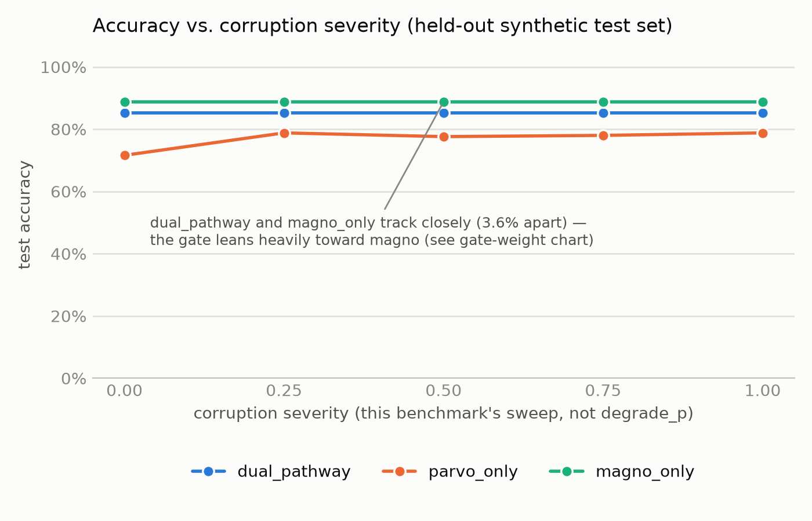
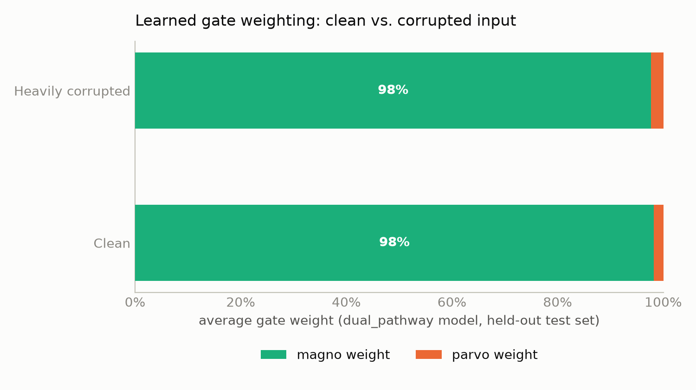
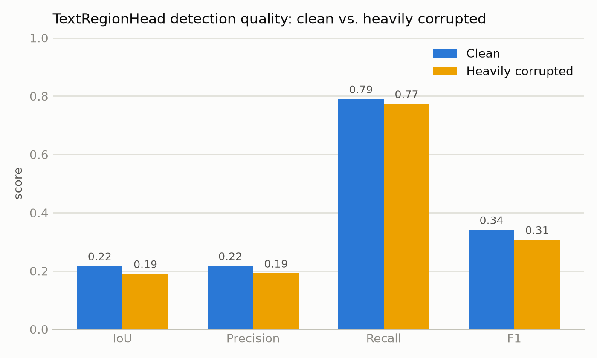
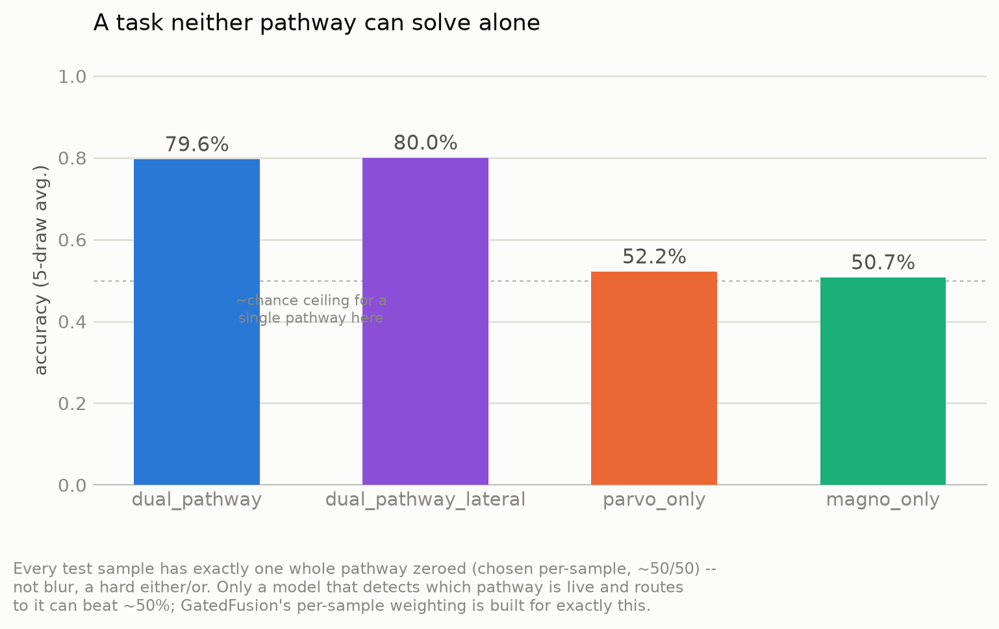
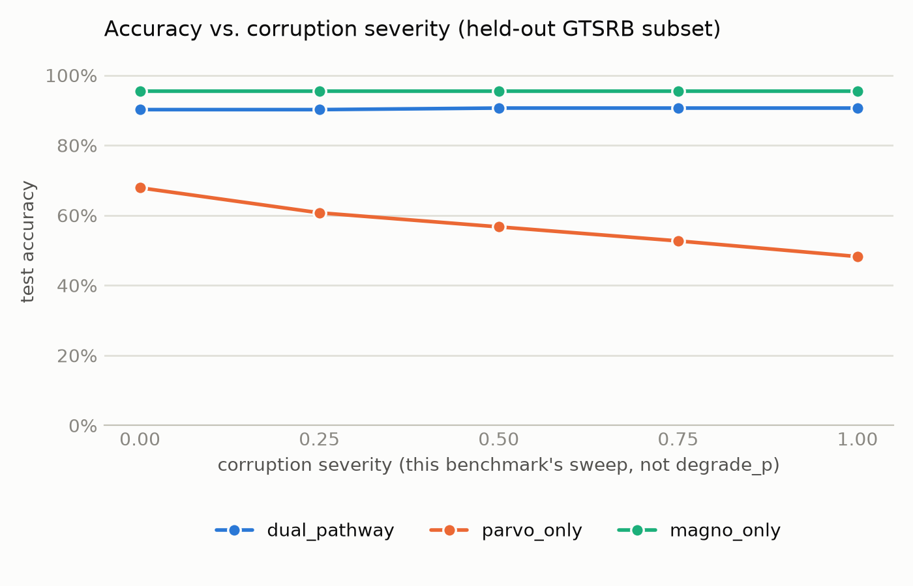
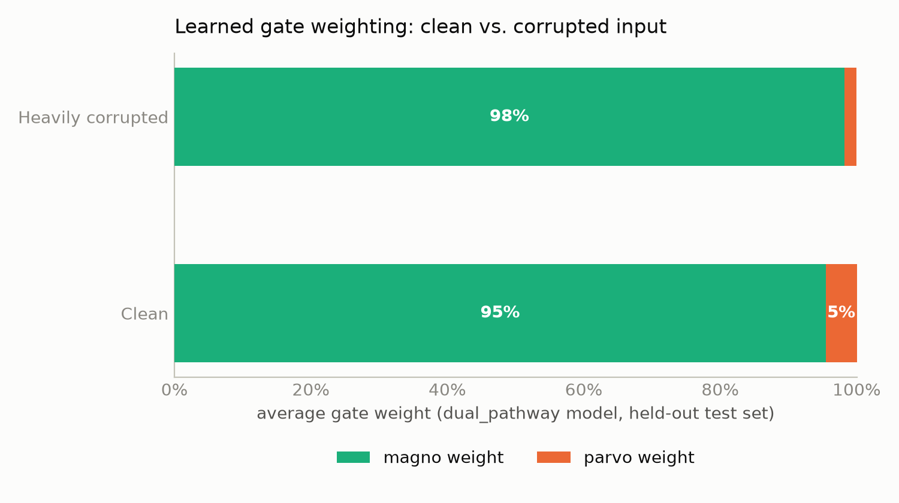
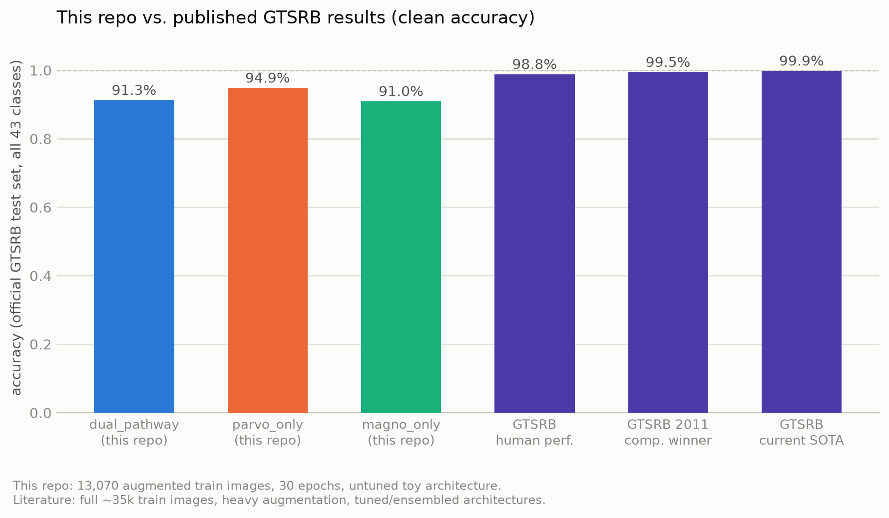
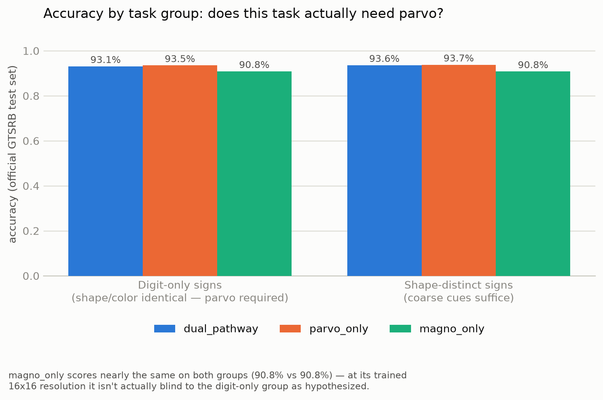
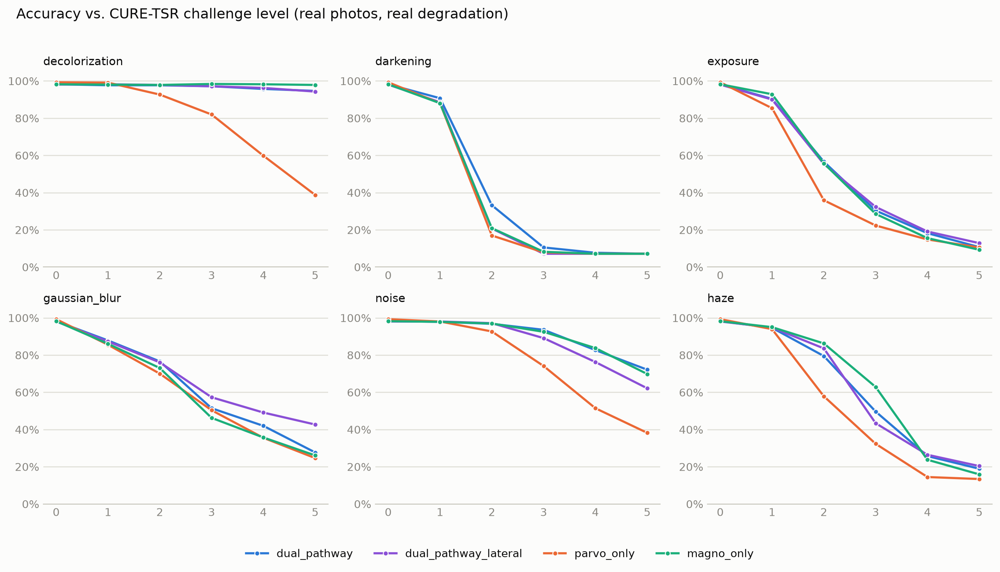
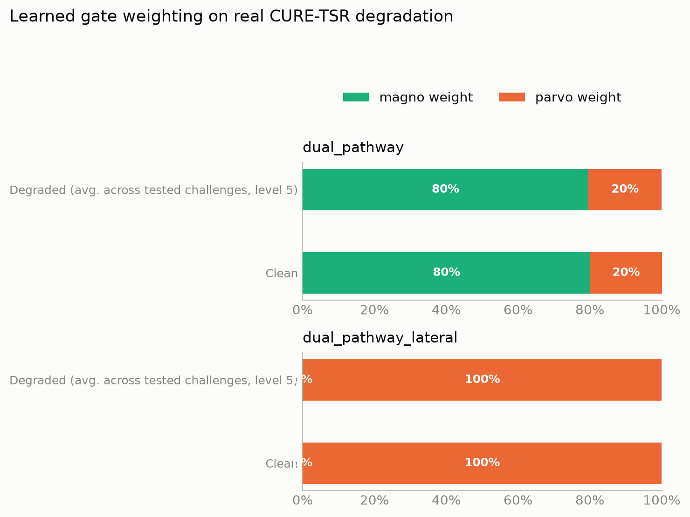

# Dual-Pathway Visual Classifier

A visual classifier inspired by the magnocellular / parvocellular split in
primate vision — one fast, coarse, low-fidelity pathway and one slow,
detailed, high-fidelity pathway, fused by a learned gate. Built with signs
and text-in-the-wild in mind: conditions where lighting, blur, or distance
can wreck fine detail but coarse shape still gets through.

## Why two pathways

| | Magno pathway | Parvo pathway |
|---|---|---|
| Input | grayscale, downsampled | full color, full resolution |
| Depth | shallow, wide receptive field | deeper, fine-grained filters |
| Speed | fast | slower |
| Good at | coarse shape/contrast, robust to noise & blur | fine detail, reading text, color cues |
| Analogous to | motion/contrast-sensitive magnocellular cells | detail/color-sensitive parvocellular cells |

Rather than picking one input representation and hoping it generalizes, the
model always sees both and learns *when to trust which one*.

## Architecture

```
gray_lowres ──▶ MagnoStream ──┐
                               ├──▶ GatedFusion ──▶ classifier ──▶ logits
color_highres ─▶ ParvoStream ─┘
                     │
                     └─▶ TextRegionHead ──▶ text mask ──▶ OCR
```

- **`MagnoStream`** — grayscale in, large strides, small feature dim. Cheap and fast.
- **`ParvoStream`** — color in, deeper conv stack. Exposes its pre-pool spatial
  feature map (`forward_spatial`) for the text head to use.
- **`GatedFusion`** — a small network looks at both feature vectors and predicts
  a per-sample weighting between them, rather than a fixed concat. Log these
  weights at inference time to see which pathway the model is actually relying
  on for a given input.
- **`LateralParvoStream` / `DualPathwayLateralClassifier`** (optional) — the
  two streams above only ever meet at `GatedFusion`, at the very end. This
  variant additionally injects magno's spatial feature map into parvo's
  trunk mid-forward (1x1-projected, resized, added in after parvo's first
  downsampling block) — the same idea as SlowFast's lateral connections for
  video (fast pathway fed into slow pathway at each stage), applied to this
  magno/parvo split instead. The intent is a cheap global-context prior for
  parvo's fine-detail processing, on top of the existing late fusion, not a
  replacement for it. See [Does a lateral connection help?](#does-a-lateral-connection-help)
  below for whether it actually does.
- **`TextRegionHead`** — parvo-only (magno's resolution can't resolve
  characters). Predicts a per-pixel text/sign-likelihood mask, which
  `text_regions_from_mask` turns into bounding boxes.
- **OCR (`ocr_read_regions`, `detect_and_read_text`)** — crops each detected
  region and reads it with `pytesseract` or `easyocr`. This is the only part
  that reads characters; the network itself only detects *where* text is.

## Training strategy

Two things keep the model honest:

1. **Random pathway degradation** (`make_dual_inputs(..., degrade_p=...)`) —
   simulates bad conditions by blurring/adding noise to the color stream for
   a fraction of samples, so magno has to carry those cases.
2. **Pathway dropout** (`train_one_epoch(..., pathway_dropout_p=...)`) —
   randomly zeroes out one entire pathway per batch, so the classifier can't
   just learn to always lean on parvo and ignore magno (or vice versa).

Without both of these, the gate tends to collapse onto whichever pathway is
higher-fidelity on average and stops learning to use the other one when it
actually needs to.

## Quickstart

```python
import torch
from dual_pathway_classifier import DualPathwayClassifier, make_dual_inputs, detect_and_read_text

model = DualPathwayClassifier(num_classes=10)

# from a single full-res color image tensor (3, H, W) in [0, 1]
gray, color = make_dual_inputs(my_image)
gray, color = gray.unsqueeze(0), color.unsqueeze(0)  # add batch dim

logits, gate_weights = model(gray, color, return_gate=True)

# classify + find + read text regions in one call
logits, gate_weights, texts = detect_and_read_text(model, gray, color, engine="tesseract")
```

Training loop:

```python
from torch.optim import Adam
from dual_pathway_classifier import train_one_epoch

optimizer = Adam(model.parameters(), lr=1e-3)
# dataloader yields (color_img_batch, label_batch, text_mask_batch_or_None)
loss = train_one_epoch(model, dataloader, optimizer, device="cpu")
```

## Requirements

- `torch`
- `scipy` (optional — enables proper multi-region connected-component
  detection in `text_regions_from_mask`; falls back to a single bounding box
  over all activated pixels without it)
- `pytesseract` + the `tesseract-ocr` system binary, **or** `easyocr`
  (optional — only needed for `ocr_read_regions` / `detect_and_read_text`)
- `typesafe-sdk` (optional — only needed for `jev_decision.py`)

```bash
pip install torch scipy
pip install pytesseract        # + apt install tesseract-ocr (or your OS equivalent)
# or
pip install easyocr
pip install typesafe-sdk       # optional, for the Jev decision layer
```

## Evaluation

`evaluate.py` is built around the fact that this architecture's whole point
is graceful degradation — so the metrics compare **across degradation
levels and against simpler baselines**, not just one clean-condition number.

**Ablation baselines** — `ParvoOnlyClassifier` and `MagnoOnlyClassifier`
drop into the same eval loop as the dual model, so you can directly check
whether fusion is earning its complexity over "just a normal color CNN" or
"just a lightweight grayscale CNN."

**Degradation curves**, not single numbers:

```python
from evaluate import compare_models, print_comparison_table

results = compare_models(
    {"dual_pathway": dual_model, "parvo_only": parvo_baseline, "magno_only": magno_baseline},
    test_loader, device, degrade_levels=(0.0, 0.25, 0.5, 0.75, 1.0),
)
print_comparison_table(results)
```

The shape of the curve is the point: `parvo_only` should fall off sharply as
`degrade_p` rises, `magno_only` should stay flat but low overall, and
`dual_pathway` should stay both high and flat if the gate is doing its job.

**Text detection** — pixel-level IoU/precision/recall/F1 for the region
head against ground-truth masks (`text_detection_metrics`).

**OCR: this pipeline vs. straight OCR on the raw image** — the specific
comparison worth running: does localizing before OCR actually help?

```python
from evaluate import evaluate_ocr_pipeline

# samples: list of (color_img_tensor, ground_truth_text) pairs
results = evaluate_ocr_pipeline(model, samples, engine="tesseract", degrade_p=0.5)
# {"raw_ocr": {"cer": ..., "wer": ...}, "detect_then_ocr": {"cer": ..., "wer": ...}}
```

Character/word error rate (CER/WER) are the standard OCR metrics — lower is
better, 0 is a perfect transcription. Expect `raw_ocr` and `detect_then_ocr`
to be close on clean, uncluttered images and to diverge as `degrade_p` rises
or background clutter increases — that gap is what localization buys you.
Run it at a few `degrade_p` values rather than just one to see the trend.

### Public benchmarks worth testing against

For a more rigorous comparison than your own held-out set:

- **[GTSRB](https://benchmark.ini.rub.de/gtsrb_news.html)** (German Traffic
  Sign Recognition Benchmark) — classification, has real varied lighting/blur.
- **[ICDAR 2015](https://rrc.cvc.uab.es/?ch=4)** / **COCO-Text** — scene text
  detection, standard for evaluating region proposals like `TextRegionHead`.
- **[SVHN](http://ufldl.stanford.edu/housenumbers/)** — house-number digits
  in natural scenes, a reasonable proxy for "read small text in the wild."
- Off-the-shelf detectors like **EAST** or **CRAFT** are the standard
  comparison points for text localization specifically, if you want to
  benchmark `TextRegionHead` against dedicated text-detection models rather
  than just against raw-OCR.


- Not a full OCR engine — `TextRegionHead` finds *where* text is, it doesn't
  read it. Reading is delegated to `pytesseract`/`easyocr`.
- Not pretrained — this is architecture + training scaffolding. You'll need
  your own labeled dataset (images, class labels, and optionally text-region
  masks) to train it.
- Box extraction without `scipy` is a coarse single-box fallback — fine for
  one sign in frame, not for scenes with multiple separated text regions.

## Results (synthetic benchmark)

There's no real labeled dataset in this repo (see caveats above), so these
charts come from `benchmark.py`: a small procedural "signs" dataset (stop /
yield / speed-limit-25 / speed-limit-45 / warning, rendered with PIL, each
with a ground-truth text mask), with `DualPathwayClassifier` and both
ablation baselines trained briefly against a random corruption-severity
sweep. `plot_results.py` renders the charts below from its output. Treat
this as a demonstration of the mechanics, not a claim about real-world
sign/text accuracy — this is still "not pretrained" scaffolding, just like
the rest of the repo.

Two of the five classes (`speed_limit_25`, `speed_limit_45`) share
identical shape and color and differ *only* by their digits, specifically
so there's a case a shape-only view structurally can't resolve — the case
fusion is supposed to help with.

**Accuracy vs. corruption severity:**



`parvo_only` degrades as corruption increases, as expected — full-color,
full-resolution input degrading is exactly what should hurt a
detail-dependent classifier. `magno_only` is flat by construction (its
input is always derived from the pre-corruption image), but notably *not*
low: at this resolution it still picks up a coarse ink-density signal for
the digit pair rather than being fully blind to it, so its flat baseline
sits above `parvo_only` at every severity level, clean included.

**Learned gate weighting:**



This is the honest result, not the idealized one: the gate collapsed onto
magno almost entirely (~98/2) at *both* clean and heavily-corrupted input —
it didn't learn to shift with severity. Given `magno_only` outperformed
`parvo_only` even on clean input in this run, collapsing onto the stronger
average pathway is the locally rational thing for the gate to learn; it's
also a direct, concrete instance of the exact failure mode the
[Training strategy](#training-strategy) section above warns about, despite
this run using both random pathway degradation *and* pathway dropout. If
you're training this for real, log gate weights like this on your own
validation set rather than assuming the mechanism worked.

**Text region detection quality:**



High recall, low precision — the trained head reliably finds *a* region
containing text but over-predicts its extent (expected from a handful of
epochs on ~750 toy images); both metrics dip modestly under heavy
corruption.

Reproduce with:

```bash
pip install pillow matplotlib  # in addition to torch, scipy
python benchmark.py    # trains the three models, writes benchmark_results.json
python plot_results.py # renders assets/*.png from that json
```

### A task neither pathway can solve alone

Everything above shows fusion being *sometimes helpful* under corruption —
never *required*. Every task tried so far (including the GTSRB digit-only
group below) turned out solvable by whichever single pathway happened to
be stronger, given enough resolution. This section builds the task the
GTSRB write-up below points at: one specifically constructed so neither
pathway can do well alone.

Construction: every sample gets exactly one whole pathway zeroed, chosen
independently per sample (~50/50) — not blur, not partial noise, a hard
per-sample either/or (something like "half your shots come from a color
camera with a dead color sensor, half from a mono-only camera with signal
dropout"). `benchmark.py` runs this as a second experiment after the one
above, training a fresh `DualPathwayClassifier` under this always-one-
pathway-missing regime (ordinary pathway dropout — a *fraction* of
batches — isn't frequent enough exposure for the gate to learn a reliable
per-sample detect-and-route policy) and fresh `ParvoOnlyClassifier`/
`MagnoOnlyClassifier` baselines trained normally on clean data (the
realistic framing: a single-sensor system is trained on good data for its
one sensor, then just happens to lose signal sometimes at deployment — if
you knew in advance when your one sensor would fail, you'd use a different
sensor).



This is the clean, decisive result the sections above don't produce:
`dual_pathway` reaches 79.6%, far above both `parvo_only` (52.2%) and
`magno_only` (50.7%), which each cap out near 50% — roughly what you'd
expect from "do well on the ~half of samples where your one pathway
happens to survive, and have literally nothing on the other half." Only a
model that can detect which pathway is live per sample and route to it
beats that ceiling, which is exactly what `GatedFusion`'s per-sample (not
global) weighting is built to do.

Reproduce with (runs automatically as part of `python benchmark.py`):

```bash
python plot_fusion_necessary.py  # renders assets/fusion_necessary.png from fusion_necessary_results.json
```

### Does a lateral connection help?

Everything above only lets magno and parvo meet once, at `GatedFusion`, at
the very end. `DualPathwayLateralClassifier` (see [Architecture](#architecture))
adds a second, earlier meeting point: magno's pooled spatial feature gets
1x1-projected and broadcast into parvo's trunk partway through, the same
idea SlowFast uses to feed its fast pathway into its slow one at each
stage. This task — the one built specifically so plain late fusion is
*required* — is the right place to ask whether an earlier connection buys
anything on top of that: `dual_pathway_lateral` reaches **80.0%** against
`dual_pathway`'s **79.6%**, trained and evaluated identically.

That's a wash, not a win — 0.4 points on a 5-draw average is well inside
this benchmark's run-to-run noise (see the GTSRB section below for a
documented same-repo case of a ~1-point ordering flip between reruns).
The honest reading: on this task, a per-sample gate that can already tell
"which pathway is alive" from the *pooled* feature vectors alone has
nothing structurally missing that an earlier, coarser broadcast of magno's
context would fix — the bottleneck here was never *when* the pathways
meet, it was routing correctly once they do, which late fusion already
handles. A lateral connection would be expected to earn more on a task
where the deficiency is spatial (parvo needing pixel-level *location* cues
from magno mid-processing, not just a global "which sensor is alive" bit)
— `CURE-TSR`'s real optical/sensor degradations below are a better test of
that than this pathway-zeroing construction, since blur/noise/darkening
distort content within a still-present pathway rather than removing one
outright.

Reproduce with (runs automatically as part of the fusion-necessary
experiment in `python benchmark.py`):

```bash
python plot_fusion_necessary.py  # now also plots dual_pathway_lateral, if present in the results json
```

## Results (real data: GTSRB subset)

Same setup, real photographs this time — a 10-class subset of
[GTSRB](https://benchmark.ini.rub.de/gtsrb_news.html) (German Traffic Sign
Recognition Benchmark): four speed-limit signs that share shape/color and
differ only by digits (`speed_30`/`50`/`60`/`70` — the real-world version
of the synthetic pair above), plus six shape-distinct classes (`stop`,
`yield`, `priority_road`, `no_entry`, `general_caution`, `keep_right`).
Split by GTSRB "track" (each physical sign is a ~30-frame burst; a random
per-image split would leak near-duplicates between train/test), 928 train /
224 test images total. See `benchmark_gtsrb.py` for the exact setup —
GTSRB itself isn't in this repo (~270MB), so this one isn't runnable
without downloading it first (instructions in the script's docstring).

**Accuracy vs. corruption severity:**



This is the cleaner result of the two: `parvo_only` shows a real, steady
decline as corruption rises (67.9% → 48.2%), `magno_only` stays flat and
strong (95.5%, structurally unaffected — same reason as above), and
`dual_pathway` (90.2–90.6%) sits close to but consistently below
`magno_only` rather than exactly matching it.

**Learned gate weighting:**



Still leans heavily on magno, but this time it's not a total freeze: parvo's
share drops from 5% clean to 2% corrupted — a real, if modest, shift in the
expected direction, unlike the synthetic run above. `dual_pathway` scoring
slightly *below* `magno_only` despite the gate mostly favoring magno is the
other honest wrinkle here: a small, partially-trusted contribution from a
noisier pathway can net out to a slight loss rather than a gain — fusion
isn't free, and this is what it looks like when the gate hasn't converged
to something better than "mostly ignore the worse pathway."

Reproduce with (after downloading GTSRB — see `benchmark_gtsrb.py`):

```bash
python benchmark_gtsrb.py  # trains the three models, writes gtsrb_results.json
python plot_gtsrb.py       # renders assets/gtsrb_*.png from that json
```

### How this compares to published GTSRB results

The two results above train under this repo's own corruption-severity
sweep, which isn't the standard benchmark protocol and isn't a fair
comparison point against the literature. `benchmark_gtsrb_full.py` is the
apples-to-apples version: all 43 classes, evaluated for clean accuracy only
(no corruption) on the **official** 12,630-image GTSRB test set — the same
number the literature reports.



Published reference points: human performance 98.84%, the original IJCNN
2011 competition's winning entry 99.46%, current published SOTA 99.85%
([paperswithcode.com/sota/traffic-sign-recognition-on-gtsrb](https://paperswithcode.com/sota/traffic-sign-recognition-on-gtsrb),
[Stallkamp et al., IJCNN 2011](https://www.ini.rub.de/upload/file/1470692848_f03494010c16c36bab9e/StallkampEtAl_GTSRB_IJCNN2011.pdf)).
This repo lands at 90.8–93.7% (13,070 near-uncapped, augmented training
images — autocontrast, rotation, scale, translation, brightness/contrast
jitter — 30 epochs, an LR schedule, weight decay, and a pathway-dropout
rate that decays from 0.15 to 0.02 over training). Still a real gap from
the literature's ~35k images and heavy augmentation on tuned/ensembled
architectures, but a big jump from the first pass — this was never
intended to be competitive with SOTA, it's a lightweight scaffold for the
dual-pathway/gating *mechanism*, not an accuracy-optimized traffic-sign
classifier, but it's worth stating the gap plainly rather than only
showing the corruption curves in isolation.

`parvo_only` (93.7%) and `dual_pathway` (93.4%) are close and consistently
ahead of `magno_only` (90.8%) on clean data: fusion's advantage in this
repo is under degraded conditions (see the two sections above), not a free
win on clean accuracy. The exact ordering between `dual_pathway` and
`magno_only` has flipped between runs (this repo's own re-runs have shown
it both ways within about a point) — small, mixed effects like this are
the actual texture of tuning a real model on a small toy dataset, reported
as observed rather than smoothed into a cleaner-sounding story.

Reproduce with (needs the official GTSRB test set too — see the script's
docstring):

```bash
python benchmark_gtsrb_full.py  # trains on all 43 classes, writes gtsrb_full_results.json + gtsrb_checkpoints/
python plot_gtsrb_full.py       # renders assets/gtsrb_full_comparison.png
```

### Which tasks actually need both pathways?

Plain classification doesn't force it — on most GTSRB classes, coarse
shape/color alone (what `magno` sees) is already enough, which is why
`magno_only` gets ~91% up above despite never seeing color or fine detail.
The one place in this dataset built specifically to require parvo is the 8
speed-limit signs (20/30/.../120 km/h): same round white/red-bordered
shape and color, differing *only* by digits. Splitting test accuracy by
that group vs. the other 35 shape-distinct classes gives a direct measure
of which task actually needs which pathway, rather than inferring it from
aggregate numbers:



The honest result here is a negative one: `magno_only` scores **90.8% on
both groups** — essentially identical. At its trained 16×16 resolution,
magno isn't actually blind to the digit-only signs the way the shape
argument predicts; some coarse ink-density/blob pattern about *which*
digits are present survives downsampling enough for it to nearly match its
performance everywhere else. (A quick, rougher check — re-evaluating the
same trained checkpoint at 8×8 and 4×4 input without retraining — showed
accuracy collapsing to single digits, but that's confounded by evaluating
a model outside the resolution its BatchNorm statistics were trained on,
not a clean measurement of information loss, so it's not reported as a
real finding here, just a caveat on how far this result generalizes.)

The practical upshot: within GTSRB, there isn't a clean task that
structurally *requires* combining both pathways — every task tried here
turns out to be solvable by whichever single pathway happens to be
stronger, given enough resolution. Building one that actually forces
fusion turned out to be more reliable by construction than by finding the
right class split — see [A task neither pathway can solve alone](#a-task-neither-pathway-can-solve-alone)
in `benchmark.py`'s results above, which sidesteps the resolution-confound
problem entirely (no retraining-at-different-resolutions needed) by
directly controlling which pathway has signal, per sample.

Reproduce with (after `benchmark_gtsrb_full.py`, which writes the grouped
numbers into `gtsrb_full_results.json`):

```bash
python plot_gtsrb_groups.py  # renders assets/gtsrb_task_groups.png
```

## Results (real varied-quality data: CURE-TSR)

GTSRB has *some* natural lighting/blur variation, but no controlled
severity axis — the corruption sweeps above are this repo's own synthetic
approximation of "bad conditions" (blur + noise) layered on top of it.
[CURE-TSR](https://github.com/olivesgatech/CURE-TSR) (Temel et al.,
"Challenging Unreal and Real Environments for Traffic Sign Recognition")
is the real-data version of that sweep: the *same* real sign photos,
re-rendered under 12 challenge types (decolorization, blur, noise, rain,
snow, haze, exposure, darkening, ...) at 5 labeled severity levels each,
plus a challenge-free baseline. `benchmark_cure_tsr.py` trains on the
challenge-free real images and evaluates a severity curve (levels 0-5) on
six of those challenges chosen for this repo's low-light/low-res theme:
decolorization, darkening, exposure, Gaussian blur, noise, and haze.

This is also a better test bed for the lateral-connection question than
the pathway-zeroing task above: CURE-TSR's degradations *distort content
within* a still-present pathway (parvo goes dark/blurry/noisy, it doesn't
disappear), rather than removing a whole pathway outright — exactly the
condition where a mid-trunk broadcast from magno was predicted to matter
more than it did above. `dual_pathway`, `dual_pathway_lateral`,
`parvo_only`, and `magno_only` are trained identically and evaluated
across all six challenge curves for a direct comparison.

CURE-TSR is gated behind a download-request form (~2.2M images total), not
shipped with this repo — same caveat as GTSRB above, see
`benchmark_cure_tsr.py`'s docstring for exactly what to request and how to
lay it out locally.

Trained on 1,806 challenge-free real images (14 sign classes, capped at 150/
class — some classes have fewer real instances than that), 20 epochs, Adam,
pathway-dropout 0.15 for both dual models. Evaluated on held-out real images
(40/class) across all 6 challenge levels for each of the six tested
challenge types.

**Accuracy vs. challenge level, per challenge type:**



`parvo_only` is consistently the worst performer as severity rises across
every challenge type — the pattern from the synthetic and GTSRB sweeps
holds on real degraded photos too. `dual_pathway` and `dual_pathway_lateral`
come out roughly tied overall (67.4% and 67.1% respectively, averaged
across all six curves and all severity levels — this single run's numbers;
see the controlled multi-seed gate-weighting discussion below for why
these exact figures shouldn't be read too precisely), both ahead of
`magno_only` (66.8%) and well ahead of `parvo_only`
(58.2%). `dual_pathway_lateral` is specifically ahead on `gaussian_blur` —
42.7% vs. `dual_pathway`'s 27.7% and `magno_only`'s 26.1% at level 5 — real
optical blur being exactly the kind of in-pathway, spatially-structured
degradation `LateralParvoStream`'s mid-trunk broadcast was designed for.

`darkening` and `exposure` are the outlier curves: every model, including
`magno_only`, collapses to chance (~7-11%, vs. 7.1% for 14 classes) by
level 4-5. Checking the actual images explains why — this isn't a modeling
failure, it's the input carrying no signal at all: a level-5 `darkening`
crop averages pixel value 11/255 (std 3), a level-5 `exposure` crop
averages 254/255 (std 1.9), against ~190/255 (std 50) for the same sign
challenge-free. At that severity CURE-TSR's darkening/exposure renders are
functionally solid black or solid white rectangles — no pathway, no matter
how it's fused, can classify a blank image. Every other tested challenge
(decolorization, blur, noise, haze) degrades the *content* while leaving
some signal in the frame; these two are the only ones that erase it
entirely at max severity, and the results reflect that honestly rather
than showing a curve that implies fusion should have saved it.

**Learned gate weighting, clean vs. heavily degraded:**



The first run of this benchmark surfaced what looked like a real problem:
`dual_pathway`'s gate landed at a stable 80/20 magno/parvo split, clean or
degraded, but `dual_pathway_lateral`'s gate collapsed to **100% parvo, 0%
magno** in both conditions — the late-fusion gate stopped using magno's
feature vector entirely. The suspected mechanism: `LateralParvoStream`
broadcasts magno's spatial feature into parvo's trunk on *every* forward
pass during training, so gradient descent could find it cheapest to stop
training the gate to use magno's vote at all, since parvo's own trunk
already has magno's context baked in by the time it reaches `GatedFusion`.
The proposed fix, `lateral_dropout_p` (`dual_pathway_classifier.py`,
`LateralParvoStream`): randomly skip the lateral broadcast for a fraction
of training batches, so parvo can't assume the broadcast will always be
there and the gate has to keep a genuine, independently useful magno vote
as a fallback. Re-running with it looked like a clean fix at first — gate
no longer collapsed, accuracy gap closed.

That first before/after wasn't a controlled comparison, though (pathway-
dropout and lateral-dropout coin flips shared Python's global `random`
module across all four models, so changing one model's training shifted
the others' draws too), so `benchmark_cure_tsr_ablation.py` was built to
isolate it properly: `DualPathwayLateralClassifier` trained twice per
seed, back to back, with identical torch weight-init and identical private
pathway-dropout draws for both arms — the *only* thing that can differ is
whether `lateral_dropout_p` is 0.0 or 0.3. Testing across three independent
seed pairs (six trainings total):

| Seed pair | no dropout (acc) | with dropout 0.3 (acc) | no-dropout gate collapsed? |
|---|---|---|---|
| 0 | 66.1% | 68.1% | No — 92%/8% clean, healthy |
| 1 | 62.8% | 66.5% | No — 82%/18% clean, healthy |
| 2 | 66.4% | 64.7% | No — 91%/9% clean, healthy |
| **mean** | **65.1% (±1.6)** | **66.4% (±1.4)** | **0/3 collapsed** |

The real finding here isn't about `lateral_dropout_p` — it's that the
**original 100%/0% collapse doesn't reproduce.** Across all six controlled
trainings (three seeds × both settings), not one gate came anywhere close
to a full collapse; every one landed on a strongly magno-leaning but
genuinely mixed split (roughly 80-92% magno clean), and every one shifted
further toward magno under degradation. The dramatic collapse in the very
first run looks like a fluke of that specific (as it turned out,
confounded) training trajectory, not a robust property of the lateral
architecture — a useful correction to the earlier writeup, and a reminder
that a single before/after on a stochastic training process isn't enough
to trust, even when the story it tells is mechanistically plausible.

`lateral_dropout_p=0.3` itself comes out with a small, mostly-positive but
noisy effect: +1.3 points on average, winning 2 of 3 seed pairs, well
within the ~1.5-point seed-to-seed spread either arm shows on its own.
That's weak evidence for "keep it as a cheap, low-downside regularizer,"
not the decisive fix the first writeup claimed — it's left on
(`lateral_dropout_p=0.3` in `benchmark_cure_tsr.py`) on that weaker
justification, not because it's been shown to reliably prevent a collapse
that, on this evidence, is rare to begin with.

Two caveats worth stating plainly: PyTorch's CPU backend isn't
bit-reproducible across separate process launches even with matching
seeds (multi-threaded float summation order varies with thread
scheduling), so "same seed" guarantees a controlled comparison *within one
script run*, not an exact repeat across runs — the three seed pairs above
are best read as three independent draws, not three exact reruns of a
fixed condition. And three seeds is enough to overturn "always collapses"
but not enough to precisely pin down `lateral_dropout_p`'s true effect
size — treat 66.4% vs. 65.1% as "probably slightly positive," not as a
settled number.

Reproduce with: `python benchmark_cure_tsr_ablation.py` (after the same
CURE-TSR download/extraction `benchmark_cure_tsr.py` needs).

### Trying to improve on these numbers

The GTSRB full-run playbook (more training data, weight_decay + LR
schedule, class weighting, spatial augmentation — see
`benchmark_gtsrb_full.py`) doesn't transfer to CURE-TSR cleanly. Bundling
all four into one run made every one of the four models *worse* by 4-5
points, including `parvo_only` and `magno_only`, which have nothing to do
with gating — so `benchmark_cure_tsr_recipe_ablation.py` isolated each
ingredient against those two single-pathway models alone (no gating
confound). In isolation: more training data and weight_decay+schedule each
genuinely help (+2 to +3 points, and they still compose when combined);
class weighting helps `magno_only` but costs `parvo_only` 5 points (net
negative); spatial augmentation costs both models 3.5-5 points on its own
— these crops are native ~17-20px, much smaller than GTSRB's, and don't
survive rotation/scale resampling the way GTSRB's larger crops do.

Applying just the two validated ingredients (more data + weight_decay/
schedule, dropping augmentation and class-weighting) back onto the full
four-model benchmark didn't reproduce the isolated gain, though: 2 of 4
models improved (`dual_pathway_lateral` +0.4, `parvo_only` +3.6) and 2 got
worse (`dual_pathway` -3.1, `magno_only` -3.1) relative to the numbers
reported above. The likely reason is the same CPU floating-point
non-determinism noted earlier, compounded by the diagnostic script using
different model-init seeds than `benchmark_cure_tsr.py`'s main run — so
this isn't a real regression, but it isn't a validated improvement either,
just an inconclusive result once seed noise is in the picture. Given that,
the recipe in `benchmark_cure_tsr.py` was left as originally committed
(150/class, 20 epochs) rather than ship a change that isolated testing
couldn't actually confirm helps end to end — the honest takeaway is that
two ingredients that clearly help a single pathway in isolation aren't
guaranteed to move the full gated system by a matching amount, and proving
that they do would need a properly seed-matched controlled test (same
approach as the lateral-dropout A/B above), not just "run it once and
compare."

Reproduce with (after requesting/downloading CURE-TSR):

```bash
python benchmark_cure_tsr.py  # trains all four models, writes cure_tsr_results.json
python plot_cure_tsr.py       # renders assets/cure_tsr_*.png from that json
```

## Decision layer (optional): Jev

The model's raw outputs aren't decisions: logits aren't calibrated
probabilities, gate weights don't say whether to trust the call, and OCR
text comes with no confidence signal at all. `jev_decision.py` packs those
three signals (predicted class + confidence, magno/parvo gate weighting,
OCR text) into a single call to [Jev](https://typesafe.ai) — TypeSafe AI's
System One model — and gets back one calibrated, type-safe decision:
whether the classification is trustworthy, whether the OCR reading is
trustworthy, and what downstream automation should actually do
(`act` / `flag_for_review` / `discard`).

```python
from jev_decision import detect_read_and_decide

class_names = ["stop", "yield", "speed_limit", ...]
logits, gate_weights, texts, jev_decisions = detect_read_and_decide(
    model, gray, color, class_names, engine="tesseract",
)
for d in jev_decisions:
    print(d.answers["action"].choice, d.answers["trust_classification"].noul)
```

Requires `pip install typesafe-sdk` and a `TYPESAFE_API_KEY` environment
variable. This is entirely optional — everything else in this repo works
without it; it just turns raw model output into something a pipeline can
act on directly instead of hand-rolling threshold logic on logits.

## File overview

| File | Contents |
|---|---|
| `dual_pathway_classifier.py` | Full model, fusion, text head, OCR integration, training loop |
| `evaluate.py` | Baselines, degradation-curve metrics, text-detection metrics, OCR comparison |
| `jev_decision.py` | Optional: turns model output into a calibrated action decision via Jev |
| `benchmark.py` | Synthetic dataset + training run behind the Results section, reproducible |
| `plot_results.py` | Renders `assets/*.png` from `benchmark.py`'s output |
| `plot_fusion_necessary.py` | Renders `assets/fusion_necessary.png` (the neither-pathway-alone task) |
| `benchmark_gtsrb.py` | Same as `benchmark.py`, on a real GTSRB subset (needs a separate download) |
| `plot_gtsrb.py` | Renders `assets/gtsrb_*.png` from `benchmark_gtsrb.py`'s output |
| `benchmark_gtsrb_full.py` | Full 43-class GTSRB, official test set, clean accuracy vs. published results |
| `plot_gtsrb_full.py` | Renders `assets/gtsrb_full_comparison.png` from `benchmark_gtsrb_full.py`'s output |
| `plot_gtsrb_groups.py` | Renders `assets/gtsrb_task_groups.png` (digit-only vs. shape-distinct accuracy) |
| `benchmark_cure_tsr.py` | Real varied-quality benchmark on CURE-TSR (real photos x 12 challenge types x 5 severity levels); needs a separate, gated download |
| `plot_cure_tsr.py` | Renders `assets/cure_tsr_*.png` from `benchmark_cure_tsr.py`'s output |
