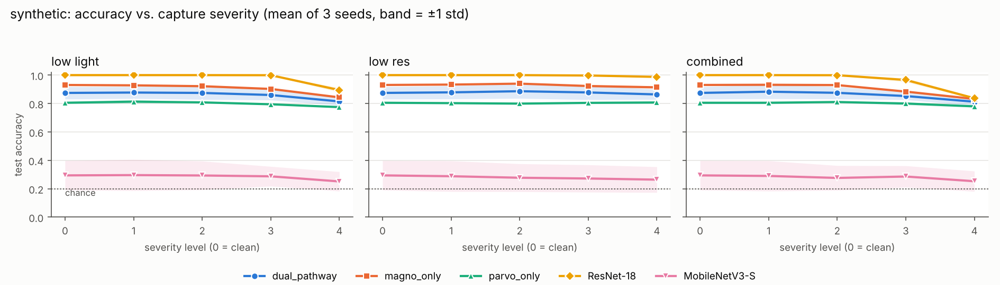
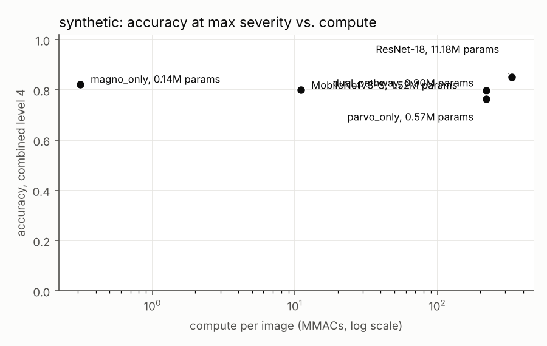

# Dual-Pathway Visual Classifier

A small visual classifier modeled on the magnocellular / parvocellular split
in primate vision: one fast, coarse pathway (grayscale, 16x16) and one slower,
detailed pathway (full color, full resolution), combined by a learned
per-sample gate. Built for signs and text in the wild, where low light, blur,
or distance destroy fine detail but coarse shape often survives.

## Results at a glance

| Question | Answer | Evidence |
|---|---|---|
| Does it match modern backbones under low light / low resolution? | Partly, on synthetic data only. In extreme low light both `dual_pathway` and `magno_only` beat MobileNetV3-Small by about 7 points on every seed, and `magno_only` does it at 1/37 of the compute. ResNet-18 still wins every condition, by 3 to 7 points at the hardest levels. | [Head-to-head](#head-to-head-vs-resnet-18-and-mobilenetv3) |
| Clean accuracy on GTSRB (43 classes, official test set) | 93.4%, vs. 99.85% published SOTA. Not competitive on clean data, and not designed to be. | [GTSRB](#gtsrb-clean-accuracy-vs-published-results) |
| Does the gate shift toward magno as input degrades? | Slightly, and inconsistently. It mostly locks onto whichever pathway is stronger on average. | [Gate behavior](#gate-behavior) |
| Is fusion ever strictly required? | Only on a constructed task where one pathway is zeroed per sample. | [Constructed task](#a-task-built-to-require-fusion) |
| Does the magno to parvo lateral connection help? | No reliable effect on any test so far. | [Lateral connection](#lateral-connection) |
| CURE-TSR (real rendered degradations) | Earlier numbers came from a leaky split and are withdrawn. Script fixed, rerun pending. | [Corrections](#corrections-october-2026) |

## Corrections (October 2026)

An audit of the analysis found two problems that inflated earlier results.
Both are fixed in code. Numbers that depended on them are withdrawn below
rather than quietly replaced.

**1. Magno saw the clean image during corruption sweeps.** `benchmark.py` and
`benchmark_gtsrb.py` corrupted only the parvo input and derived the magno
input from the uncorrupted image. A real camera produces one degraded frame,
so any model with a magno pathway was being handed information no deployed
system would have. This is why `magno_only` looked perfectly flat across
severity and why `dual_pathway` appeared to beat `parvo_only` under
corruption. Fix: both pathways are now derived from the same corrupted
frame. The synthetic sweep has been rerun (below). The 10-class GTSRB
severity sweep needs the GTSRB download to rerun, so its old numbers
(`gtsrb_results.json`, `assets/gtsrb_severity_curve.png`,
`assets/gtsrb_gate_weights.png`) should be treated as invalid until then.

**2. CURE-TSR train and test images came from the same pool.**
`benchmark_cure_tsr.py` (and both ablation scripts, which import its
helpers) ignored the release's train/test folders and drew 150 training and
40 "held-out" images per class from one shuffled pool with two different
seeds. Some test photos were literally training photos, many others were
adjacent frames of the same video, and every degraded test image was a
re-render of a frame from that pool. That explains the ~98% clean accuracy,
well above what the CURE-TSR paper reports for its baselines. Fix:
`index_dataset(root, split)` now requires the official `Real_Train` /
`Real_Test` folders and raises if it cannot find them. All CURE-TSR numbers
previously in this README (the severity grid, the 67.4% / 67.1% / 66.8% /
58.2% averages, the blur result for the lateral model, the lateral-dropout
seed table, and the recipe ablation) are withdrawn pending a rerun. Their
JSON files are kept for the record, not as results.

What survives the audit: GTSRB full clean accuracy (official test set, no
corruption), the GTSRB digit-only vs. shape-distinct split, the constructed
fusion-required task (with the caveat noted there), and everything in the
new head-to-head section.

## Head-to-head vs. ResNet-18 and MobileNetV3

`benchmark_vs_sota.py` puts this repo's models against two standard modern
backbones, ResNet-18 (11.2M params) and MobileNetV3-Small (1.5M params, an
architecture built for efficient on-device inference), under one protocol:

- **One degraded frame per sample, then both pathways derived from it.** A
  capture simulator models a camera in the dark and at a distance: photon
  shot noise, read noise, 8-bit quantization at the sensor's exposure, then
  digital gain (auto-exposure), plus area downsampling for distance. Three
  sweeps: low light only, low resolution only, and both combined.
- **Identical training for every model:** same data, same random capture
  conditions during training, Adam with weight decay and a one-cycle
  schedule, 60 epochs, 3 seeds. Every model is trained from scratch, since
  pretrained weights are not reachable from the environment these runs used.
- **Cost reported next to accuracy:** parameters, MACs at the input size,
  single-thread CPU latency.

Dataset: the 5-class synthetic signs from `benchmark.py` (two of the classes,
`speed_limit_25` and `speed_limit_45`, differ only by their digits), 750
training and 500 test images at 96px. GTSRB and CURE-TSR runs use the same
script (`--dataset gtsrb`, `--dataset cure`) and need the datasets locally.



| Model | Params | MMACs | CPU ms | Clean | Low light, max | Low res, max | Combined, max |
|---|---|---|---|---|---|---|---|
| ResNet-18 | 11.18M | 333.1 | 9.3 | 100.0 ± 0.0 | **94.0 ± 1.6** | **99.7 ± 0.4** | **85.2 ± 1.0** |
| `magno_only` | 0.14M | 0.3 | 0.2 | 98.9 ± 0.7 | 87.1 ± 0.8 | 96.7 ± 1.2 | 82.3 ± 0.7 |
| `dual_pathway` | 0.90M | 220.8 | 4.9 | 98.2 ± 0.9 | 87.3 ± 0.2 | 94.5 ± 1.8 | 79.9 ± 0.8 |
| MobileNetV3-Small | 1.52M | 11.1 | 3.0 | 93.0 ± 9.5 | 80.4 ± 0.3 | 90.7 ± 8.3 | 79.9 ± 0.3 |
| `parvo_only` | 0.57M | 220.3 | 4.5 | 80.4 ± 1.1 | 78.1 ± 0.9 | 81.3 ± 0.5 | 76.4 ± 0.7 |

Accuracy in %, mean ± std over 3 seeds. "Max" is the hardest level of each
sweep: 0.3% of normal light (about 3 photons at full white), 18% linear
resolution (a 96px sign reduced to about 17px), or both at once. Full
per-level numbers are in `vs_sota_synthetic_results.json`.



**The use case that holds up: extreme low light on a compute budget.** At the
darkest level, `magno_only` (86.6 to 88.2% across seeds) and `dual_pathway`
(87.0 to 87.6%) both beat MobileNetV3-Small (80.0 to 80.6%) on every seed,
with no overlap. `magno_only` gets there with 0.3 MMACs and 0.14M params,
about 1/37 of MobileNetV3-Small's compute and 1/1000 of ResNet-18's. In the
combined dark-and-far condition the margin over MobileNetV3-Small shrinks to
about 2 points for `magno_only` and disappears for `dual_pathway`.

**What it does not show:**

- **Parity with ResNet-18.** ResNet-18 wins every condition. The closest
  either model gets is the combined max level, where `magno_only` is 3 points
  behind with non-overlapping seed ranges (81.4 to 83.0% vs. 83.8 to 86.2%).
  "Within 3 points at 1/1000 of the compute" is the accurate claim, not "on par."
- **That fusion is what earns it.** `magno_only` matches or beats
  `dual_pathway` in every column. On this task the 16x16 grayscale pathway
  carries the result, and the color pathway plus gate add 220 MMACs without
  adding accuracy.
- **SOTA in the benchmark sense.** Neither baseline is pretrained or tuned
  for this data. They are standard architectures trained under the same
  budget, which is a fair comparison but not a comparison against published
  SOTA numbers.
- **Real data.** Five synthetic classes is a small, easy task. The GTSRB and
  CURE-TSR runs are the test that matters.

Two training notes. At 20 epochs, MobileNetV3-Small failed to converge on
all three seeds (29% clean, near chance) and `dual_pathway` was also
undertrained, so every model was rerun at 60. Even at 60 epochs one
MobileNetV3-Small seed plateaued at about 80%, which is the source of its
large clean-accuracy std. `parvo_only` plateaus at about 80% on every seed
<!-- PARVO_NOTE -->.

## Architecture

```
gray_lowres ──▶ MagnoStream ──┐
                               ├──▶ GatedFusion ──▶ classifier ──▶ logits
color_highres ─▶ ParvoStream ─┘
                     │
                     └─▶ TextRegionHead ──▶ text mask ──▶ OCR
```

| | Magno pathway | Parvo pathway |
|---|---|---|
| Input | grayscale, downsampled to 16x16 | full color, full resolution |
| Depth | 3 strided convs, ~0.3 MMACs | 5 conv blocks, ~220 MMACs at 96px |
| Good at | coarse shape and contrast | fine detail, digits, color |

- **`MagnoStream`**: grayscale in, large strides, small feature dim.
- **`ParvoStream`**: color in, deeper conv stack. `forward_spatial` exposes the
  pre-pool feature map for the text head.
- **`GatedFusion`**: a small MLP looks at both feature vectors and predicts a
  per-sample weighting between them. Log these weights at inference to see
  which pathway the model relies on.
- **`DualPathwayLateralClassifier`** (optional): additionally injects magno's
  spatial features into parvo's trunk after its first downsampling block,
  like SlowFast's lateral connections. `lateral_dropout_p` randomly skips that
  injection during training.
- **`TextRegionHead`**: parvo-only per-pixel text mask, turned into boxes by
  `text_regions_from_mask`.
- **OCR (`ocr_read_regions`, `detect_and_read_text`)**: crops each detected
  region and reads it with `pytesseract` or `easyocr`. The network only finds
  *where* text is. It does not read characters itself.

## Training strategy

1. **Degraded training samples.** The color stream is blurred or noised for a
   fraction of samples (`make_dual_inputs(..., degrade_p=...)`, or the capture
   simulator in `benchmark_vs_sota.py`).
2. **Pathway dropout** (`train_one_epoch(..., pathway_dropout_p=...)`) zeroes
   one whole pathway per batch so the classifier cannot ignore either one.

Without both, the gate tends to collapse onto whichever pathway is stronger
on average. In practice it often does anyway (see [Gate behavior](#gate-behavior)).

## Quickstart

```python
from dual_pathway_classifier import DualPathwayClassifier, make_dual_inputs, detect_and_read_text

model = DualPathwayClassifier(num_classes=10)
gray, color = make_dual_inputs(my_image)            # my_image: (3, H, W) in [0, 1]
gray, color = gray.unsqueeze(0), color.unsqueeze(0)

logits, gate_weights = model(gray, color, return_gate=True)
logits, gate_weights, texts = detect_and_read_text(model, gray, color, engine="tesseract")
```

```python
from torch.optim import Adam
from dual_pathway_classifier import train_one_epoch

optimizer = Adam(model.parameters(), lr=1e-3)
# dataloader yields (color_img_batch, label_batch, text_mask_batch_or_None)
loss = train_one_epoch(model, dataloader, optimizer, device="cpu")
```

## Requirements

```bash
pip install torch torchvision scipy pillow matplotlib
pip install pytesseract   # + apt install tesseract-ocr, or: pip install easyocr
pip install typesafe-sdk  # optional, only for jev_decision.py
```

`scipy` is optional (multi-region boxes in `text_regions_from_mask`, else one
box over all activated pixels). Not pretrained: you need your own labeled data.

## Detailed results

### Synthetic signs: corruption sweep

The original `benchmark.py` sweep (`benchmark_results.json`,
`assets/severity_curve.png`, `assets/gate_weights.png`) is superseded. It was
run before the magno clean-image fix (see Corrections), and the head-to-head
above is the corrected version of the same experiment on the same synthetic
signs. `benchmark.py` itself now derives both pathways from the corrupted
frame if you want to rerun it.

One part of that run should be largely unaffected, because the text head
only ever sees the parvo input (it was trained jointly with the leaky model,
so not strictly independent of it): the `TextRegionHead` mask has high recall (0.75)
and low precision (0.23 clean, 0.21 under heavy corruption). It reliably
finds the text region and over-predicts its extent.


### A task built to require fusion

Every test sample has exactly one pathway zeroed, chosen at random per
sample. `dual_pathway` is trained under the same always-one-missing regime,
while the single-pathway baselines are trained on clean data.


| Model | Accuracy, one pathway missing per sample |
|---|---|
| `dual_pathway_lateral` | 80.0% |
| `dual_pathway` | 79.6% |
| `parvo_only` | 52.2% |
| `magno_only` | 50.7% |

This experiment trains and evaluates on clean inputs (before any pathway is
zeroed), so the magno clean-image fix does not change it.

Caveat: this is a construction, not a deployment scenario. Both pathways are
derived from one camera frame here, so in a real system they fail together,
and the ~50% ceiling for the baselines follows by construction from "no
input on half the samples." Read it as a check that the gate can route per
sample, not as evidence that fusion helps on natural data.

### GTSRB: clean accuracy vs. published results

All 43 classes, official 12,630-image test set, no corruption, so the number
is comparable to the literature (`benchmark_gtsrb_full.py`).


| Model | Clean accuracy |
|---|---|
| Published SOTA ([paperswithcode](https://paperswithcode.com/sota/traffic-sign-recognition-on-gtsrb)) | 99.85% |
| IJCNN 2011 winner ([Stallkamp et al.](https://www.ini.rub.de/upload/file/1470692848_f03494010c16c36bab9e/StallkampEtAl_GTSRB_IJCNN2011.pdf)) | 99.46% |
| Human | 98.84% |
| `parvo_only` | 93.7% |
| `dual_pathway` | 93.4% |
| `magno_only` | 90.8% |

13,070 training images, 30 epochs, augmentation, LR schedule, weight decay,
decaying pathway dropout. A 6-point gap to SOTA on clean data. Reruns have
swapped the order of `dual_pathway` and `parvo_only` within about a point,
so treat them as tied.

**Digit-only vs. shape-distinct classes.** The 8 speed-limit signs differ only
by digits, so they should need parvo. They do not: `magno_only` scores 90.8%
on both groups. At 16x16, enough of the digit pattern survives for magno to
tell them apart.


### Gate behavior

Across every run, the gate leans heavily on whichever pathway is stronger on
average and shifts only a few points with degradation. Gate weights are
logged per run in the result JSONs (`gate_weights`). If you train this for
real, check them on your own validation set rather than assuming the
mechanism works.

### Lateral connection

On the constructed fusion task, `dual_pathway_lateral` and `dual_pathway`
tied (80.0% vs. 79.6%, within run-to-run noise). The CURE-TSR results that
appeared to favor it on Gaussian blur came from the leaky split and are
withdrawn. The earlier finding that a "100% parvo" gate collapse in the
lateral model did not reproduce across three seed pairs still stands as a
statement about that (leaky) setup only.

### CURE-TSR

[CURE-TSR](https://github.com/olivesgatech/CURE-TSR) (Temel et al.) renders
real sign photos under 12 challenge types at 5 levels. It is the right real-
data test for this repo, and it is gated behind a request form, so it is not
included. `benchmark_cure_tsr.py` and `benchmark_vs_sota.py --dataset cure`
both expect `cure_tsr_data/Real_Train/...` and `cure_tsr_data/Real_Test/...`.
Results will be added after a rerun on the official split.

One observation from the old runs that does not depend on the split: at
levels 4-5, CURE-TSR's `darkening` and `exposure` renders are close to solid
black (mean pixel 11/255) or solid white (254/255). No model can classify
those, so expect every curve to hit chance there.

## Decision layer (optional): Jev

`jev_decision.py` sends the predicted class and confidence, the gate weights,
and the OCR text to [Jev](https://typesafe.ai) (TypeSafe AI) and gets back a
calibrated decision: whether to trust the class and the OCR reading, and
whether to `act`, `flag_for_review`, or `discard`. Needs `typesafe-sdk` and a
`TYPESAFE_API_KEY`. Nothing else depends on it.

```python
from jev_decision import detect_read_and_decide
logits, gate_weights, texts, decisions = detect_read_and_decide(model, gray, color, class_names)
```

## Reproducing

| Result | Command | Data |
|---|---|---|
| Head-to-head, synthetic | `python benchmark_vs_sota.py --dataset synthetic && python plot_vs_sota.py synthetic` | none |
| Head-to-head, GTSRB | `python benchmark_vs_sota.py --dataset gtsrb && python plot_vs_sota.py gtsrb` | GTSRB train + official test |
| Head-to-head, CURE-TSR | `python benchmark_vs_sota.py --dataset cure && python plot_vs_sota.py cure` | CURE-TSR Real_Train / Real_Test |
| Synthetic sweep + fusion task | `python benchmark.py && python plot_results.py && python plot_fusion_necessary.py` | none |
| GTSRB clean accuracy | `python benchmark_gtsrb_full.py && python plot_gtsrb_full.py && python plot_gtsrb_groups.py` | GTSRB train + official test |
| GTSRB 10-class sweep | `python benchmark_gtsrb.py && python plot_gtsrb.py` | GTSRB train |
| CURE-TSR sweep and ablations | `python benchmark_cure_tsr.py`, `benchmark_cure_tsr_ablation.py`, `benchmark_cure_tsr_recipe_ablation.py` | CURE-TSR |

Download instructions for each dataset are in the matching script's docstring.

## Files

| File | Contents |
|---|---|
| `dual_pathway_classifier.py` | Model, fusion, lateral variant, text head, OCR, training loop |
| `evaluate.py` | Single-pathway baselines, degradation curves, text-detection and OCR metrics |
| `benchmark_vs_sota.py`, `plot_vs_sota.py` | Head-to-head vs. ResNet-18 / MobileNetV3 with a shared capture simulator |
| `benchmark.py`, `plot_results.py`, `plot_fusion_necessary.py` | Synthetic sweep and the fusion-required task |
| `benchmark_gtsrb_full.py`, `plot_gtsrb_full.py`, `plot_gtsrb_groups.py` | GTSRB 43-class clean accuracy |
| `benchmark_gtsrb.py`, `plot_gtsrb.py` | GTSRB 10-class sweep (needs rerun, see Corrections) |
| `benchmark_cure_tsr*.py`, `plot_cure_tsr.py` | CURE-TSR sweep and ablations (needs rerun, see Corrections) |
| `jev_decision.py` | Optional decision layer |
